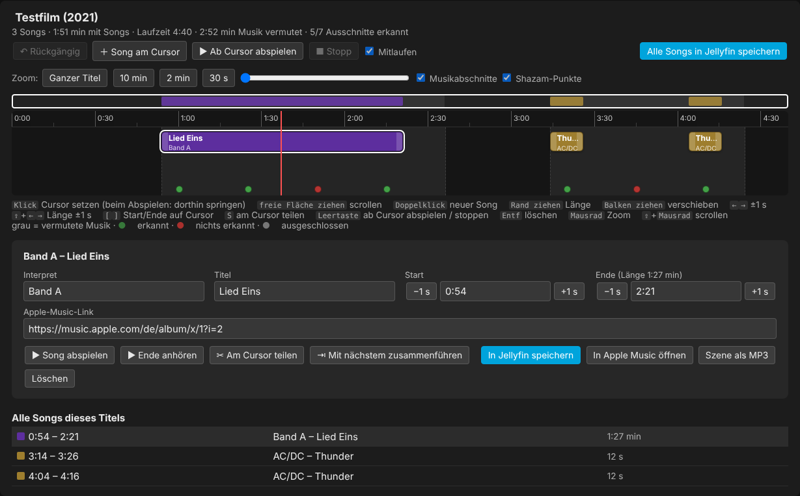

<!-- #claude -->
# Soundtrack Finder for Jellyfin

Find out which songs play in your movies and TV episodes. Soundtrack Finder listens to your own media files, identifies the music with Shazam, and adds a song list to every title in Jellyfin. You can fix the results on a timeline, listen to each scene, and save songs to a Jellyfin music library as tagged MP3s.



> The user interface is currently in **German**. See [CHANGELOG.md](CHANGELOG.md) for the version history.

## Features

- **Automatic song recognition.** A nightly task (2:00 AM) scans the libraries you choose. It looks for stretches that sound like music, sends short samples to Shazam, and merges the hits into songs with start and end times.
- **Song list in the description.** Each title's overview gets a `🎵 Songs` block with times, artist, title and a link to the timeline. The block stays in place after metadata refreshes and updates as soon as you edit songs.
- **Timeline editor.** Shows songs as blocks, the sections that sound like music in grey, and every Shazam sample as a dot (green = match, red = no match). You can:
  - drag a block to move it or drag its edges to change the length
  - add, delete, rename, split and merge songs
  - undo up to 40 steps
  - zoom and scroll, and use keyboard shortcuts
- **Listen in place.** Play from the cursor, a whole song, or just its end, streamed straight from your file.
- **Save to Jellyfin as music.** Each song is cut from your own file into an MP3, with tags, the poster as cover art and a short fade in and out. Movies become albums (`Movie (Year)/01 - Artist - Title.mp3`); series become one album per season. The music library is rescanned automatically.
- **Scene as MP3.** Download any song section as an MP3.
- **"Now playing" pop-up.** While you watch, a short note shows the song that just started. Each user can turn it off, and a diagnostics panel with a test button helps when nothing shows up.
- **Search and statistics.** Search all titles by song or artist, and see top artists and songs.
- **For all users.** Every signed-in user can open the Soundtracks page (`/SoundtrackFinder/App`), see the titles their library access allows, and edit and save songs. Changes are recorded with the user's name. Starting analyses and changing settings is limited to admins.
- **Exclusion list.** Hide false matches such as sound-effect libraries ("Sound Ideas", "ASMR", "Karaoke", …), including from titles that were already analyzed.

## Requirements

- **Jellyfin 12.4** (the plugin targets ABI `12.4.0.0` and .NET 10)
- Internet access from the Jellyfin server to Shazam
- The ffmpeg bundled with Jellyfin; no extra setup is needed
- Optional: a **writable** folder for saved songs that is also added to Jellyfin as a **Music** library

## Installation

### Option A: plugin repository (recommended)

1. In Jellyfin, open **Dashboard → Plugins → Repositories → ＋** and add
   - Name: `Soundtrack Finder`
   - URL: `https://raw.githubusercontent.com/AloneArcticBear/jellyfin-plugin-soundtrack-finder/main/manifest_claude.json`
2. Open **Catalog**, find **Soundtrack Finder** and install it.
3. Restart Jellyfin.

Installing from the repository also gives you update notifications. It removes the "An error occurred while getting the plugin details from the repository" notice that Jellyfin shows for plugins it can't find in any repository.

### Option B: manual install

1. Download `SoundtrackFinder_<version>_claude.zip` from [Releases](https://github.com/AloneArcticBear/jellyfin-plugin-soundtrack-finder/releases).
2. Unzip it into Jellyfin's `plugins` folder so you get `…/config/plugins/SoundtrackFinder_<version>/` containing the DLL and `meta.json`. Keep only one version in that folder.
3. Restart Jellyfin.

Docker example:

```bash
cd /path/to/jellyfin/config/plugins
rm -rf SoundtrackFinder_1.*
unzip ~/SoundtrackFinder_1.3.2.0_claude.zip -d .
docker restart jellyfin
```

Your results are kept across updates in `config/plugins/Jellyfin.Plugin.SoundtrackFinder/`.

## Setup

1. **Dashboard → Plugins → Soundtrack Finder → Einstellungen:** select the movie and series libraries to scan.
2. Optional: to test before the nightly run, open a title and click **Neu analysieren**, or start everything now with **Alle offenen jetzt analysieren** on the **Fortschritt** card.

### Saving songs as music (optional)

1. Create a folder for the songs and mount it **read-write** into the container, for example:
   ```yaml
   volumes:
     - /srv/media/Soundtracks:/media/Soundtracks
   ```
   Give it to the user Jellyfin runs as (`docker exec jellyfin id`, then `chown uid:gid`). Don't put it inside a movie or TV library.
2. In Jellyfin, add a library of type **Music** with the folder `/media/Soundtracks`.
3. In the plugin settings, set **Zielordner für Songs** to `/media/Soundtracks`.

If the folder isn't writable or isn't part of a music library, the plugin shows a yellow warning with the reason. To let other users play the saved songs, give them access to the music library under **Dashboard → Users → Access**.

### Helping users find the Soundtracks page

- **Link in every description.** The `🎵 Songs` block contains "▶ anhören & bearbeiten", which opens that title on the Soundtracks page. Set **Öffentliche Jellyfin-Adresse** in the settings to your public Jellyfin URL; it defaults to `JELLYFIN_PublishedServerUrl`.
- **Menu entry.** Jellyfin Web can show custom links (`menuLinks` in `jellyfin-web/config.json`). With Docker, take the original file out of the image, add an entry, and mount it read-only:
  ```bash
  docker run --rm --entrypoint cat jellyfin/jellyfin:latest /jellyfin/jellyfin-web/config.json > web-config.json
  python3 - <<'PY'
  import json
  c = json.load(open('web-config.json'))
  c['menuLinks'] = [l for l in c.get('menuLinks', []) if l.get('url') != '/SoundtrackFinder/App'] \
      + [{"name": "Soundtracks", "icon": "music_note", "url": "/SoundtrackFinder/App"}]
  json.dump(c, open('web-config.json', 'w'), indent=2, ensure_ascii=False)
  PY
  ```
  ```yaml
  volumes:
    - ./web-config.json:/jellyfin/jellyfin-web/config.json:ro
  ```
  Repeat the first step after Jellyfin updates so you keep the upstream defaults.
- **Dashboard.** The plugin page shows the page's address with a copy button.

The Soundtracks page uses the normal Jellyfin sign-in of the same browser, so it must be opened under the same address as Jellyfin.

## Using the timeline

Open a title from the list (dashboard plugin page or `/SoundtrackFinder/App`).

| Action | How |
|---|---|
| Set the cursor | Click the track or the time ruler; during playback this jumps there |
| Play / stop | **Space** (plays from the cursor until you stop) |
| Move a song | Drag the block, or select it and press **← / →** (±1 s, **Alt** for ±0.1 s) |
| Change the length | Drag an edge, **Shift + ← / →** moves the end, **[** / **]** set start or end to the cursor |
| New song | Double-click an empty spot, or "＋ Song am Cursor" |
| Split / merge | **S** splits at the cursor; "⇥ Mit nächstem zusammenführen" merges with the next song |
| Delete | **Delete** / **Backspace** (also removes a saved MP3) |
| Undo | **Ctrl/⌘ + Z** |
| Zoom / scroll | Mouse wheel zooms; **Shift + wheel** or dragging an empty area scrolls |

Every edit is saved immediately and marked as manual (✎). Manual songs are never overwritten by a new analysis.

## "Now playing" pop-ups

When a recognized song starts, Jellyfin Web shows a short note such as `🎵 Artist – Title` at the bottom of the screen. This works in clients that support server messages (`DisplayMessage`), such as Jellyfin Web. Some mobile and TV apps don't support them.

- Admins can turn the feature off globally and set how long the note stays. Each user can turn it off for themselves on the Soundtracks page.
- The panel next to the switch shows, per device, what is playing, whether the app supports pop-ups, and when the next song starts. **Test-Einblendung senden** sends a test note right away.
- After a Jellyfin restart, a browser may need a reload before it reports pop-up support again.

## Settings

| Setting | Default | Meaning |
|---|---|---|
| Libraries | none | Libraries included in the nightly scan |
| Sample spacing / length | 25 s / 12 s | How often and how long audio is sampled inside music sections |
| Pause between requests | 4000 ms | Delay between Shazam requests |
| Max requests per title | 250 | Upper limit per movie or episode |
| Music sensitivity | 5 | 1 = strict, 10 = check everything |
| Max titles per night | 0 (unlimited) | Spreads large libraries over several nights |
| Write to overview / link | on / on | Song block in the description, with a link to the timeline |
| Public URL | `JELLYFIN_PublishedServerUrl` | Base URL for links in descriptions |
| Now playing | on, 6 s | Pop-up while watching |
| Exclusion list | Sound Ideas, ASMR, Sound Effects, Soundeffekte, White Noise, Karaoke, TV Theme Tune Factory | Matches containing one of these texts in "artist – title" are ignored |
| Export folder, fade, bitrate, album artist | empty, 1 s, 192 kbit/s, "Soundtracks" | Options for saving songs as music |

## Permissions

| | Users | Admins |
|---|---|---|
| View titles, timeline, listen | ✓ (only titles they have access to) | ✓ |
| Edit, add, split, merge, delete songs | ✓ | ✓ |
| Save to Jellyfin, scene as MP3 | ✓ | ✓ |
| Analyze, analyze all, save all, stop, exclude an artist, settings | – | ✓ |

## How it works

1. ffmpeg decodes the audio at 16 kHz mono. A simple loudness heuristic finds sections that are probably music.
2. Inside those sections, short samples are fingerprinted (a C# port of the [SongRec](https://github.com/marin-m/SongRec) signature algorithm) and sent to Shazam.
3. Neighboring hits of the same track are merged into songs. Manual edits, exclusions and saved MP3s carry over when a title is analyzed again.
4. Results are stored as JSON in the plugin's data folder. The description block is written through Jellyfin's metadata API.

The plugin never downloads music. Saved MP3s are cut from your own media files, so they contain the movie's soundtrack mix, which may include dialogue and sound effects.

## Building from source

Requires the .NET 10 SDK.

```bash
git clone https://github.com/AloneArcticBear/jellyfin-plugin-soundtrack-finder.git
cd jellyfin-plugin-soundtrack-finder/SoundtrackFinder_claude
dotnet build -c Release
# output: bin/Release/net10.0/Jellyfin.Plugin.SoundtrackFinder.dll
```

The project references `Jellyfin.Controller` and `Jellyfin.Model` 12.4 from NuGet. To build offline, put the Jellyfin 12.4 assemblies (`MediaBrowser.*.dll`, `Jellyfin.Data.dll`, `Jellyfin.Database.Implementations.dll`, `Jellyfin.Extensions.dll`) in a `jfref/` folder next to the project folder; the build uses them automatically.

### Publishing a release

1. Bump `AssemblyVersion`/`FileVersion` in the `.csproj` and build.
2. Zip `Jellyfin.Plugin.SoundtrackFinder.dll` and `meta.json` with no subfolder and attach the ZIP to a GitHub release tagged `v<version>`.
3. Add a new entry at the top of `versions` in `manifest_claude.json`, with `sourceUrl` pointing to the release asset and `checksum` set to the ZIP's MD5 (`md5sum file.zip`).

## Disclaimer

This project is not affiliated with Jellyfin, Shazam or Apple. Song recognition uses an unofficial Shazam endpoint that can change or stop working at any time. Keep request rates low (the defaults are deliberately slow) and use the plugin for your personal library only.

## License

GPL-3.0, like Jellyfin and its plugin template.
